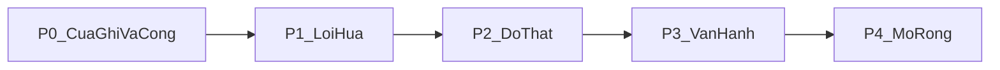

# Plan thực thi mira-harness (P0 đến P4)

Sau khi duyệt, ghi nguyên văn tài liệu này vào [docs/PLAN.md](docs/PLAN.md). Chưa sửa code ở bước này. Nguồn sự thật là code vừa đọc, không phải số dòng trong [mira-harness_ke-hoach-cai-tien.md](mira-harness_ke-hoach-cai-tien.md). Phương án P0-03 khóa theo khuyến nghị B của MD. Không thêm dependency. Không nới I1, I2, I3, I5, I6, I8.

Lưu ý lệch MD, không được bỏ qua:

- Docstring đầu [r0/team.py](r0/team.py) chỉ định nghĩa I1, I2, I3, I5, I8. I6 chỉ có một dòng ở [r0/pipeline.py](r0/pipeline.py) dòng 7. I4 và I7 không tồn tại trong repo. Fuzz không được bịa thêm hai bất biến này.
- P0-05 chỉ đúng với `Ledger.charge`. Vòng agent dùng giá đoán `UNKNOWN_PRICE` ở [r0/agent.py](r0/agent.py) dòng 34, không phải `$0`. Sửa cả hai đường, nhưng không giữ giá đoán để “van vẫn chạy”.
- MD nói `r0/tools.py:575-578` và `:464`. Jail path thật là `_denied_path` dòng 185 và `_resolve` dòng 476. File người chấm là `_freeze_block` dòng 556.
- MD kể `chon_dat.ansi` và `chon_dat*.png`. Thư mục gốc hiện có `cach-dung-moi.txt`, `labels.csv`, `chon_dat.sh`. Ảnh ANSI/PNG không có.
- `plan_hash` ở [r0/pipeline.py](r0/pipeline.py) dòng 178 dùng `hash()`, đổi theo process. P0-02 chỉ ghi giá trị đó vào trace. Đổi sang SHA256 thuộc P1-03.
- `subprocess.run` của `run_shell` không truyền `env=`, nên process con thừa kế `ANTHROPIC_API_KEY`. MD để ở P3-03 nhưng ghi “nếu đang truyền thì sửa ngay mức P0”. Làm trong P0-07, không hoãn.



## 0. Bằng chứng đọc code

Mỗi dòng dưới là một hàng của bảng bắt buộc. Cột: mục, file, dòng, trích dẫn, đúng hay sai so với MD.

- P0-01. [r0/team.py](r0/team.py) 450 và 544-545. `child = Session(root=Path(root), mode="acceptEdits", approve=lambda _t, _a: True)` rồi `if root is not None and shape_of(plan.task_text) == "sua": worker_steps = [_worker_edit(prev)]`. Đúng MD: worker dạng `sua` ghi cây thật trước verifier. Verifier ở dòng 574, sau lời gọi này.
- P0-01 cổng sau. [r0/team.py](r0/team.py) 741-748. `if st != "ok": ... withheld.json`. Đúng: FAIL chỉ giữ hồ sơ, không hoàn tác file worker đã sửa.
- P0-02 tính cờ. [r0/pipeline.py](r0/pipeline.py) 174-176. `dual = bool(floor["floor"] >= 3 or tier == 3)`. Đúng.
- P0-02 thi hành. [r0/team.py](r0/team.py) 752-759. `need = plan.gate_tier >= 2` rồi một lần `input(...)`. `dual_approval` không được đọc. Đúng: một lần hỏi.
- P0-02 test. [tests/test_invariants.py](tests/test_invariants.py) 105-108. `if r["floor"] >= 3: self.assertTrue(r["dual_approval"])`. Đúng: chỉ assert boolean.
- P0-03. [r0/team.py](r0/team.py) 36-44. `2: ["planner", "worker", "verifier"]` và `TAIL_ROLES = ()`. Dòng 622: `oracle_score is not None and oracle_score < 0.7`. Đúng: nhánh chết vì score luôn None.
- P0-04. [r0/team.py](r0/team.py) 268-270. `m = re.search(r"[A-Za-z]+", text or "")`. Đúng. “Kết luận: PASS” ra chữ `K`.
- P0-05 đội. [r0/team.py](r0/team.py) 244-248 và 463-464. `usd = 0.0` khi không có trong `C.PRICES`; `_over_cap` chỉ so `total_usd`. Đúng với Ledger.
- P0-05 agent. [r0/agent.py](r0/agent.py) 32-34 và [r0/config.py](r0/config.py) 53. `p = C.PRICES.get(model) or C.UNKNOWN_PRICE`. MD nói “mọi model lạ ra $0” là sai với vòng agent. Hiểu đúng: team thì $0 và van tê; agent thì đoán giá 5/15 USD mỗi triệu token.
- P0-06. [r0/stats.py](r0/stats.py) 20-22. `raise FileNotFoundError(f"không thấy {mf} — chạy r0-shadow run ...")`. [r0/cli.py](r0/cli.py) 409-415 `cmd_selftest` chỉ gọi `unittest discover`. [.github/workflows/test.yml](.github/workflows/test.yml) 21-26 chạy `python -m r0 run` trước unittest. Đúng hướng MD. Số “287 test” không chạy lại trong phiên lập plan này; không lấy số đó làm mốc mới.
- P0-06 README. [README.md](README.md) 6 `CLI v1.15.0` và dòng 132 `28 bài OK`. [pyproject.toml](pyproject.toml) dòng 6 `version = "2.5.0"`. [r0/__init__.py](r0/__init__.py) không có `__version__`. Đúng lệch phiên bản.
- P0-07. [README.md](README.md) 255 `không bao giờ ghi ra tệp`. [r0/keys.py](r0/keys.py) 45-51 `save()` ghi JSON và `chmod` trong `try/except OSError`. [r0/cli.py](r0/cli.py) 682 `--api-key`. Đúng.
- P0-07 shell. [r0/tools.py](r0/tools.py) 1212-1213 `subprocess.run(...)` không có `env=`. Đúng là con thừa kế môi trường. MD xếp P3 nhưng yêu cầu sửa ngay nếu đúng. Làm ở P0-07.
- P0-08. [r0/team.py](r0/team.py) 26 và 28 `from pathlib import Path` hai lần. CI chỉ `"3.12"`. Không có `LICENSE`. Artifact thật: `labels.csv`, `cach-dung-moi.txt`, `chon_dat.sh`. MD sai tên file ảnh.
- S1 giữ. [r0/pipeline.py](r0/pipeline.py) `t1a_policy` chỉ đọc observable. Không đổi hàm này trừ khi mục nói rõ.
- S4 giữ. [r0/tools.py](r0/tools.py) 185 `path.resolve().relative_to(root)` và 476 `_resolve`. Số dòng MD `:464` là cũ.
- S6 giữ. [r0/tools.py](r0/tools.py) 556-557 chặn path người chấm khi không có trong câu việc.
- P1-05. [r0/agent.py](r0/agent.py) 643 `approve=(lambda t, a: True) if args.yes`. Đúng số dòng MD.
- P2-01. [r0/tasks.py](r0/tasks.py) 177-179 `build_tasks` dùng `random.Random(seed)`. Đúng là thước synthetic.
- P2-04. [r0/team.py](r0/team.py) 320 `prev=(pv or "")[:12000]`. Đúng cắt cụt.
- I1 executor. [r0/team.py](r0/team.py) 640-641 `_executor_write` tự nhận là cửa ghi duy nhất, nhưng `_worker_edit` đã ghi trước đó. Mâu thuẫn nội bộ, P0-01 xử lý.

## 1. Phân rã P0

### P0-01 Write-through-staging

a. Thay đổi code

- `_worker_edit` trong [r0/team.py](r0/team.py): `Session.root` đổi từ `Path(root)` sang `.mira/staging/<run-id>/`. Copy cây nguồn vào staging trước `run_turn`, bỏ `.git`, `.env`, `__pycache__`. `approve` vẫn `True` trong staging vì cổng người nằm sau promote, không nằm trong worker.
- Hàm mới `promote_staging(real_root, staging, audit) -> list[str]`: chỉ gọi từ `cmd_team` sau khi `status=="ok"` và người đã duyệt. Mỗi file đổi so với bản nguồn được `os.replace` vào cây thật và một dòng audit `promote`.
- Khi `status!="ok"` hoặc người từ chối: `shutil.rmtree(staging)` hoặc đổi tên thành `.mira/staging/<run-id>.withheld`. Cây `root` không `replace`.
- `_executor_write` vẫn ghi `result.md` trong `--out`, thêm danh sách path đã promote. Không dùng nó để vá file nguồn.
- `_resolve` không đổi luật `..`. Staging là `root` của Session con nên jail khóa trong staging của run-id đó.

b. Test viết trước, file `tests/test_wts.py`

- `test_verifier_fail_cay_that_khong_doi`: task `sua` có `app.py`, provider giả trả worker edit rồi verifier `FAIL`. Assert hash `app.py` trên cây thật bằng hash trước lượt. Assert staging còn hoặc đã đánh dấu withheld.
- `test_pass_nhung_nguoi_tu_choi_khong_promote`: verifier `PASS`, stdin `n`. Assert cây thật không đổi và không có file mới ngoài staging.
- `test_pass_va_duyet_promote_dung_file`: stdin `y`. Assert chỉ file staging khác nguồn xuất hiện trên cây thật, audit có `promote`.
- `test_hai_run_song_song_khong_dung_staging`: hai `run-id` khác nhau, ghi `a.txt` và `b.txt`. Assert không file nào của run này nằm trong staging run kia.

c. Lệnh

```bash
python3 -m unittest tests.test_wts -v
python3 -m r0 selftest
```

Trên máy Windows đang dùng: `py -3 -m unittest tests.test_wts -v`.

d. Commit

`[P0-01] Ghi sửa của worker vào staging, chỉ promote sau verifier và cổng người`

Ước lượng: khoảng 180 dòng `r0/team.py`, 120 dòng test.

### P0-02 Hai khóa khi dual_approval

a. Thay đổi code

- `cmd_team`: nếu `plan.dual_approval` thì không dùng một `input` yes/no. Sinh hai cụm 4 từ tiếng Việt, hỏi hai vòng. Mỗi vòng nhận `tên` và `cụm`. Trùng tên thì trả mã thoát 5, không gọi `_executor_write`.
- `--approve` khi `dual_approval` thì thoát mã 6 trước `execute_plan`, không gọi model.
- Trace thêm hai bản ghi `gate_person`: tên, thời điểm, `plan_hash` lấy từ `human_gate` như hiện tại. Không đổi công thức `hash()`.

b. Test, file `tests/test_dual_gate.py`

- `test_hai_ten_khac_nhau_thi_duoc_ghi`: stdin hai cặp đúng mật khẩu, tên `an` và `binh`. Assert exit 0 và trace có 2 bản ghi.
- `test_trung_ten_bi_tu_choi`: cả hai vòng tên `an`. Assert exit 5, không có `result.md`.
- `test_sai_mat_khau_vong_hai`: vòng hai gõ sai cụm. Assert không promote, exit khác 0.
- `test_approve_bi_chan_khi_dual`: `args.approve=True` và tier 3. Assert exit 6 và provider giả không bị gọi.

c. Lệnh: `python3 -m unittest tests.test_dual_gate tests.test_invariants -v`

d. Commit: `[P0-02] Bắt hai người khác tên khi dual_approval, chặn --approve`

Ước lượng: 90 dòng `cmd_team`, 100 dòng test.

### P0-03 Oracle bật tắt rõ, không giả đã chấm

a. Thay đổi code

- Chọn phương án B. Không nhét oracle vào `ROLES_BY_LANE` vô điều kiện.
- `cmd_team` thêm `--oracle on|off`. Mặc định `on` khi làn 2 và surface khác `read_only`. `read_only` mặc định `off`.
- Khi `on`: `plan.roles` làn 2 thành `planner, worker, verifier, oracle`. `TAIL_ROLES` gồm `oracle` chỉ trong lần chạy đó.
- Khi `off`: không gọi oracle. Kết quả thêm `oracle_gate: "disabled"`. `status=="ok"` vẫn được nếu verifier PASS, nhưng trace không được thiếu cờ này.
- README dòng 262 sửa thành: cổng 0,70 chỉ chạy khi oracle bật.

b. Test, thêm vào `tests/test_team.py`

- `test_oracle_cham_0_4_thi_withheld`: system chứa `ORACLE`, body `SCORE: 0.4`. Assert `status=="withheld"`.
- `test_oracle_cham_0_9_thi_ok`: `SCORE: 0.9`. Assert `status=="ok"` và `oracle_score>=0.9`.
- `test_oracle_tat_khong_gia_da_cham`: `--oracle off`. Assert không có step `oracle`, `oracle_gate=="disabled"`, không có `oracle_score` giả.

c. Lệnh: `python3 -m unittest tests.test_team.RosterTest tests.test_team -k oracle -v`

d. Commit: `[P0-03] Bật oracle bằng cờ, ghi disabled khi cổng không chạy`

Ước lượng: 70 dòng team/cli, 80 dòng test, 15 dòng README.

### P0-04 Không suy diễn PASS

a. Thay đổi code

- Đổi `_first_word` thành `_verdict_token`. Chỉ chấp nhận dòng đầu, sau `strip`, đúng `PASS` hoặc `FAIL`. Khác, kể cả `PASSED`, `pass` có khoảng trắng thừa hai đầu đã strip thì `pass` viết thường sau strip là `pass` không phải `PASS`. Kỳ vọng MD: chỉ `PASS` nguyên vẹn. Vậy sau strip phải bằng đúng `PASS` hoặc `FAIL`.
- “Kết luận: PASS” không khớp, trả `None`.
- Chỗ dòng 585-596: `None` không được gán thành chữ `K`. Giữ `verifier_verdict is None` để nhánh 618 withheld với lý do `verifier không theo giao thức, giữ lại`.

b. Test, `tests/test_verdict.py`

- `test_pass_dung_tung_chu`: `"PASS"` ra `PASS`, status ok khi các cổng khác đạt.
- `test_ket_luan_pass_bi_withheld`: `"Kết luận: PASS"` ra None và status withheld.
- `test_pass_thuong_va_passed_va_rong`: `" pass "`, `"PASSED"`, `""` đều withheld, không status ok.

c. Lệnh: `python3 -m unittest tests.test_verdict -v`

d. Commit: `[P0-04] Chỉ nhận đúng PASS hoặc FAIL, lệch giao thức thì giữ lại`

Ước lượng: 40 dòng team, 60 dòng test.

### P0-05 Model không giá thì không gọi

a. Thay đổi code

- Trước `_call` và trước `run_turn` trong `_worker_edit`: nếu model không có trong `C.PRICES` và không có giá khai trong plan, trả `blocked` với câu `model X chưa có giá`, không mở HTTP.
- CLI team thêm `--price-in IN,OUT` đơn vị USD mỗi 1 triệu token. Giá này ghi vào ledger `priced=True`, `declared_by_user=True`.
- `_over_cap` giữ so `total_usd`, nhưng usd không còn luôn 0 với model lạ đã khai giá.
- [r0/agent.py](r0/agent.py) `_price`: bỏ fallback `UNKNOWN_PRICE` khi gọi model thật. Không có giá và không có `--price-in` thì `run_turn` trả `blocked` trước provider. `--dry-run` của team vẫn đếm token, không cần giá.
- Sửa test đang chờ `$0` hoặc chờ giá đoán dương cho model lạ. Test `test_model_la_van_co_gia` trong `tests/test_disk_guard.py` đổi thành assert blocked, vì MD cấm coi giá đoán là van.

b. Test, `tests/test_price_gate.py`

- `test_model_la_bi_chan_truoc_http`: provider giả đếm số request. Model `khong-co`. Assert 0 request và status blocked.
- `test_khai_gia_thi_nhan_dung_va_dung_tran`: `--price-in 2,2`, usage 1_000_000/0, cap nhỏ hơn 2 USD. Assert usd bằng 2 và `stopped_budget` khi vượt.
- `test_dry_run_van_dem_token_khong_can_gia`: `dry_run=True`. Assert không blocked vì giá, `tokens_in==0` vì không gọi.

c. Lệnh: `python3 -m unittest tests.test_price_gate tests.test_disk_guard -v`

d. Commit: `[P0-05] Chặn model chưa có giá trước request, nhận giá khai trên dòng lệnh`

Ước lượng: 80 dòng team/agent/cli, 70 dòng test.

### P0-06 selftest tự chứa và một số phiên bản

a. Thay đổi code

- Mọi test đọc `out/metrics.json` hoặc `out/trace.jsonl` chuyển sang `tempfile.TemporaryDirectory` trong `setUp`, gọi hàm ghi metrics vào đó, `tearDown` xóa. Cấm `Path("out")` tương đối trong `tests/`.
- `tests/test_tui.py`: không gọi curses thật. Tách hàm tính bảng nếu nó nằm chung với curses, rồi mock. Nếu không tách được trong phạm vi mục, skip có lý do khi không có TTY bị cấm. MD yêu cầu mock, nên tách phần đọc số khỏi `curses`.
- [.github/workflows/test.yml](.github/workflows/test.yml): xóa bước `python -m r0 run` khỏi job unittest. Thêm job `shadow` riêng chạy `r0 run`, không `needs` từ unittest.
- [r0/__init__.py](r0/__init__.py) thêm `__version__ = "2.5.0"`. `pyproject.toml` dùng dynamic version trỏ file này. README dòng 6 và 132 sửa cho khớp `__version__` và câu “selftest là unittest, phải PASS, không cần thư mục out”.
- Test mới assert README, pyproject và `__version__` cùng một chuỗi.

b. Test

- `test_selftest_khong_can_thu_muc_out` trong `tests/test_selftest_isolated.py`: xóa `out` nếu có trong tmp checkout giả lập bằng cách chạy một test stats với đường dẫn tmp, assert không đọc `./out`.
- `test_stats_thieu_file_bao_loi_ro`: `_load` trên thư mục trống raise `FileNotFoundError` chứa `metrics.json`. Đây là nhánh fail-closed của màn stats, không phải của selftest.
- `test_ba_nguon_version_khop`: đọc `__version__`, field project, và dòng README.

c. Lệnh, trên clone không có `out/`:

```bash
rm -rf out out-v112
python3 -m r0 selftest
```

d. Commit: `[P0-06] Để selftest chạy trên clone sạch và một nguồn version`

Ước lượng: 120 dòng dời fixture test, 40 dòng CLI/README, 40 dòng test version.

### P0-07 Khóa không vào argv, không vào log, không vào shell con

a. Thay đổi code

- README dòng 255 đổi thành thứ tự thật: tham số, biến môi trường, rồi `~/.r0/keys.json` plaintext mode 0600. Ghi rõ Windows bỏ qua chmod.
- `save()` khi `os.name=="nt"` in một dòng cảnh báo tiếng Việt, không nuốt im.
- Thêm `--api-key-env TEN`. Giữ `--api-key` nhưng in cảnh báo và ghi trace `argv_key_warning` không kèm giá trị khóa. Parser không đưa giá trị khóa vào help example.
- `run_shell`: `subprocess.run(..., env=cleaned)`. `cleaned` là bản sao môi trường đã xóa mọi tên trong `keys.ENV` và mọi biến kết thúc bằng `_API_KEY`.
- Log `mask()` giữ như cũ. Test quét chuỗi `sk-test-EXPOSE-0123456789`.

b. Test, `tests/test_key_leak.py`

- `test_save_ghi_file_va_readme_khong_noi_doi`: nội dung README sau sửa không còn câu “không bao giờ ghi ra tệp”. `keys.save` tạo file. Assert file chứa khóa chỉ trong bài test tmp, không in ra stdout của `print_status`.
- `test_argv_key_bi_canh_bao_khong_lot_trace`: chạy parser với `--api-key sk-test-EXPOSE-0123456789`, capture stdout. Assert chuỗi `EXPOSE` vắng trong stdout và trong trace.
- `test_shell_con_khong_thay_khoa`: `run_shell` với env đã cài khóa giả, lệnh in env. Assert stdout lệnh không chứa `EXPOSE`. Dùng mode bypass trong tmp, không gọi mạng.

c. Lệnh: `python3 -m unittest tests.test_key_leak tests.test_keys -v`

d. Commit: `[P0-07] Khai đúng chỗ khóa nằm, cấm khóa trong argv và trong shell con`

Ước lượng: 100 dòng keys/cli/tools, 80 dòng test, 20 dòng README. Không thêm gói `keyring` ở mục này.

### P0-08 LICENSE, gốc repo, CI bốn phiên bản Python

a. Thay đổi code

- Thêm `LICENSE` đúng văn MIT, năm 2026, tên giữ theo copyright đang có trong README nếu có; nếu README không có tên pháp lý thì dùng tên repo `wuongg/mira-harness` và ghi trong commit. Không bịa tên người.
- Đưa `cach-dung-moi.txt` và `chon_dat.sh` vào `docs/`. `labels.csv` thêm vào `.gitignore` và xóa khỏi git nếu đang track. Không đụng `chon_dat.ansi` vì file không tồn tại.
- Xóa dòng import `Path` trùng, giữ dòng 26.
- CI matrix `python-version: ["3.9","3.10","3.11","3.12"]` nhân `ubuntu-latest` và `windows-latest`. Job shadow chỉ 3.12 để đỡ tốn, unittest thì đủ bốn.
- Thêm `CHANGELOG.md` mục Unreleased và `CONTRIBUTING.md` năm luật: không dependency, tiếng Việt, một mục một commit, không yếu cổng, test trước.

b. Test

- `test_license_ton_tai`: đọc `LICENSE`, assert có chữ `MIT`.
- `test_goc_khong_con_labels_csv_trong_git`: `git ls-files labels.csv` rỗng sau khi bỏ track. Test này chạy được khi file đã untrack; nếu chưa, assert `.gitignore` chứa `labels.csv`.
- `test_compileall_team`: `compileall.compile_file` trên `r0/team.py` không ném, và file không còn hai dòng `from pathlib import Path`.

c. Lệnh: `python3 -m compileall -q r0 && python3 -m unittest tests.test_repo_hygiene -v`

d. Commit: `[P0-08] Thêm LICENSE, dọn gốc repo, CI từ Python 3.9 đến 3.12`

Ước lượng: 40 dòng YAML, 30 dòng test, file LICENSE khoảng 20 dòng.

## 2. Phân rã P1 đến P4

P1 không bắt đầu nếu P0 chưa đạt mục XONG KHI ở phần 3.

### Giai đoạn P1-A: P1-01 và P1-02

a. Hành vi

- Verifier và oracle: system prompt yêu cầu một khối JSON `{"verdict","reasons","evidence","confidence"}`. `verdict` chỉ `PASS` hoặc `FAIL`. Oracle thêm `score` 0 đến 1. `json.loads` thất bại thì withheld, trace `protocol=fallback` chỉ khi dòng đầu đúng `PASS` hoặc `FAIL` như P0-04. Không đoán từ “Kết luận”.
- Native: nếu provider có tool, thêm schema `submit_verdict`. Không có thì vẫn nhận JSON trong chữ.
- Evidence: với task `sua`, trước khi nhận score, chạy lệnh trong câu việc nếu có, trong staging của P0-01. Exit khác 0 thì withheld dù score cao. Diff rỗng mà worker nói đã sửa thì withheld. `ok` cần verifier PASS và, khi oracle bật, score >= 0.70 và exit 0 nếu có lệnh.

b. Test `tests/test_envelope.py`

- `test_json_pass_duoc_nhan`
- `test_json_hong_bi_withheld`
- `test_pytest_do_mac_score_cao_van_withheld`
- `test_diff_trong_worker_noi_da_sua_bi_fail`

c. Lệnh: `python3 -m unittest tests.test_envelope tests.test_verdict -v`

d. Commit: `[P1-01] Nhận verdict bằng JSON, chấm thêm bằng exit code và diff`

Ước lượng: 220 dòng team/agent, 150 dòng test.

### Giai đoạn P1-B: P1-04 và P1-05

a. Hành vi

- File `r0/prices.toml`. Python 3.11+ dùng `tomllib`. 3.9 và 3.10 dùng parser hẹp chỉ bảng `[models]` và hai số, không thêm thư viện. Thứ tự: `--price-in`, rồi toml, rồi `MIRA_PRICE_<MODEL>`, không có thì chặn như P0-05.
- `--yes` và mode `bypass` chỉ sống khi surface là `read_only` hoặc `write_sandbox`. `egress_new` hoặc nhãn `confidential`/`restricted` thì `cmd_agent` thoát mã 7, không tạo Session duyệt sẵn.

b. Test `tests/test_price_file.py` và `tests/test_yes_gate.py`

- `test_cli_thang_toml`
- `test_toml_thang_env`
- `test_khong_nguon_nao_thi_chan`
- `test_yes_read_only_duoc`
- `test_yes_egress_bi_chan`
- `test_bypass_confidential_bi_chan`

c. Lệnh: `python3 -m unittest tests.test_price_file tests.test_yes_gate tests.test_price_gate -v`

d. Commit: `[P1-04] Đọc giá từ prices.toml theo thứ tự khai báo` và `[P1-05] Cấm --yes khi egress hoặc nhãn hạn chế`

Ước lượng: 160 dòng, 120 dòng test.

### Giai đoạn P1-C: P1-03 và P1-06

a. Hành vi

- Mỗi dòng trace thêm `prev_hash` và `hash` SHA256 của canonical JSON. Cuối run ghi `manifest.json`.
- `mira verify <dir>` trả 0 nếu chuỗi khớp, 1 nếu sửa, xóa, hoặc chèn.
- Fuzz trong `tests/test_fuzz_invariants.py`: 200 kịch bản, seed `C.SEED`. Hoán worker, độ sâu, vị trí FAIL, lỗi provider. Assert không ghi ngoài promote và `_executor_write`, `Ledger.charge` 50 luồng không mất cộng, tổng đội con không vượt trần cha.

b. Test

- `test_sua_mot_ky_tu_verify_fail`
- `test_xoa_mot_dong_verify_fail`
- `test_khong_sua_verify_pass`
- `test_fuzz_200_seed_co_dinh` một test bao 200 vòng, assert không exception và không ghi lậu.

c. Lệnh: `python3 -m unittest tests.test_verify tests.test_fuzz_invariants -v`

d. Commit: `[P1-03] Xích hash cho trace và lệnh mira verify` rồi `[P1-06] Fuzz 200 kịch bản giữ cửa ghi và sổ cái`

Ước lượng: 200 dòng verify, 180 dòng fuzz.

## P2

### P2-01 và P2-02

a. Thư mục `eval/adversarial/` ít nhất 100 file hoặc một JSONL 100 dòng, mỗi dòng có `input`, `expected` là `block` hoặc `allow`, `axis`. Trục bắt buộc: lệnh ẩn, giả danh, path `../`, homoglyph, trộn tiếng Việt. `mira eval --suite adversarial` in precision và recall từng trục. Báo cáo shadow RNG ghi chữ `synthetic`. CI job mới fail nếu recall trục `lenh_an` dưới 0.90. Ngưỡng này là trần MD đã ghi, không hạ.

b. Test

- `test_case_path_ngoai_bi_chan`
- `test_case_allow_doc_file_trong_cau`
- `test_thieu_axis_thi_lenh_eval_loi`
- `test_recall_duoi_nguong_tra_ma_1` bằng bộ giả 2 case.

c. Lệnh: `python3 -m r0 eval --suite adversarial`

d. Commit: `[P2-01] Thêm bộ eval đối kháng và cổng recall trên CI`

Ước lượng: 100 case dữ liệu, 150 dòng runner.

### P2-03 và P2-04

a. `mira ingest <trace-dir>` đổ 16 chỉ số từ trace thật vào bảng stats, cột nguồn `real`. Shadow giữ `synthetic`. `_user_of` không cắt cụt 12000 im lặng. Giữ nguyên câu việc và hai bước cuối. Phần cũ hơn ghi `context_policy` là `full`, `truncated`, hoặc `summarized`. Tóm tắt không gọi model mới nếu chưa có giá. Cắt theo đoạn, ghi `truncated`, vẫn giữ câu việc.

b. Test

- `test_ingest_ghi_nguon_real`
- `test_shadow_van_synthetic`
- `test_chuoi_dai_khong_mat_cau_viec`
- `test_trace_co_context_policy`

c. Lệnh: `python3 -m unittest tests.test_ingest tests.test_context_budget -v`

d. Commit: `[P2-03] Nạp trace thật vào stats, nén hội thoại có ghi chính sách`

Ước lượng: 180 dòng.

## P3

### P3-01 và P3-02

a. `BaseProvider._post` và `native._request`: tối đa 3 lần cho HTTP 429 và 5xx, backoff 0.5, 1, 2 giây cộng jitter. 4xx khác 429 không retry. Timeout 180 giây giữ. Ledger chỉ `charge` lần thành công. Trace có `attempt`. Checkpoint `.mira/runs/<id>/checkpoint.json` sau mỗi vai. `mira team --resume <id>` đọc ledger đã chi, không charge lại bước đã có. Staging P0-01 giữ nguyên khi resume.

b. Test

- `test_429_roi_200_chi_tinh_mot_lan_tien`
- `test_400_khong_retry`
- `test_resume_khong_cong_lai_usd`
- `test_resume_thieu_checkpoint_thi_loi`

c. Lệnh: `python3 -m unittest tests.test_retry tests.test_resume -v`

d. Commit: `[P3-01] Retry 429 và 5xx không tính tiền hai lần` và `[P3-02] Resume đội từ checkpoint cùng sổ cái`

Ước lượng: 200 dòng.

### P3-03 và P3-04

a. Phần xóa khóa khỏi shell đã làm ở P0-07. P3-03 chỉ thêm cảnh báo khi Linux không có `bwrap`, và optional extra `sandbox` rỗng trong pyproject, không kéo gói. Nếu `bwrap` có trên PATH thì `run_shell` bọc như nhánh Linux đang có trong `_shell_argv`. P3-04: extra `otel` không nằm trong `dependencies`. Không có `MIRA_OTLP_ENDPOINT` thì không import. Có endpoint thì span ghi role, model, usd, verdict. Nếu không thêm được exporter mà vẫn 0 dependency, ghi span ra JSONL cục bộ thay vì kéo SDK. MD cho optional dependency. Chọn JSONL cục bộ để không thêm thư viện. Ghi rõ trong README đây không phải OTLP đầy đủ.

b. Test

- `test_khong_bwrap_van_chay_va_canh_bao`
- `test_otel_tat_khong_tao_file`
- `test_otel_bat_ghi_span_khong_kem_khoa`

c. Lệnh: `python3 -m unittest tests.test_sandbox_note tests.test_otel_local -v`

d. Commit: `[P3-03] Cảnh báo khi không có bwrap, không đưa khóa vào shell` và `[P3-04] Ghi span cục bộ khi bật MIRA_OTLP_ENDPOINT`

Ước lượng: 120 dòng. Không thêm package PyPI.

## P4

### P4-01 và P4-02

a. Worker `sua` trả unified diff. Code parse diff, từ chối path ra ngoài staging, path không nằm trong câu việc, và path người chấm. Apply vào staging rồi mới tới P0-01 promote. Plugin `.mira/plugins/<ten>/plugin.json` chỉ được tool nằm trong allowlist. Tool ghi của plugin gọi cùng `promote_staging`, không gọi `Path.write_text` riêng. `vet_roster` từ chối tool ghi thứ hai.

b. Test

- `test_diff_path_ngoai_bi_tu_choi`
- `test_diff_file_nguoi_cham_bi_tu_choi`
- `test_diff_hop_le_vao_staging`
- `test_plugin_hai_tool_ghi_bi_tu_choi`

c. Lệnh: `python3 -m unittest tests.test_diff_proposal tests.test_plugin -v`

d. Commit: `[P4-01] Worker nộp diff trước khi apply vào staging` và `[P4-02] Plugin chỉ thêm tool đi qua cửa promote`

Ước lượng: 250 dòng.

### P4-03 và P4-04

a. Tám file ADR chỉ cho bất biến có thật: I1, I2, I3, I5, I6, I8. Không viết ADR-I4 hay ADR-I7. Mỗi file: bối cảnh, quyết định, hậu quả, lệnh test chứng minh. `README.en.md` có What, Why, Quickstart, Invariants, Threat model. README tiếng Việt giữ. Không dịch máy từng dòng.

b. Test

- `test_adr_du_sau_bat_bien_that`
- `test_khong_co_adr_i4`
- `test_readme_en_co_threat_model`

c. Lệnh: `python3 -m unittest tests.test_docs -v`

d. Commit: `[P4-03] Ghi ADR cho bất biến đang có trong code` và `[P4-04] Thêm README tiếng Anh theo threat model`

Ước lượng: 8 file ADR ngắn, khoảng 40 dòng mỗi file, README.en khoảng 120 dòng.

## 3. Lộ trình

- Giai đoạn P0. XONG KHI: tám commit P0-01 đến P0-08 có trên nhánh, `python3 -m r0 selftest` PASS trên thư mục không có `out/`, checklist Phần I các dòng P0 là có bằng chứng lệnh. Bị chặn: không bắt đầu P1, không làm eval đối kháng, không làm plugin.
- Giai đoạn P1. XONG KHI: envelope, giá toml, chặn `--yes`, `mira verify`, fuzz 200. Bị chặn: P2 không chạy cổng CI recall.
- Giai đoạn P2. XONG KHI: `mira eval --suite adversarial` in được recall và CI fail khi tụt ngưỡng, ingest phân biệt real và synthetic. Bị chặn: không gọi P2 là thước chính nếu mới chỉ có shadow RNG.
- Giai đoạn P3. XONG KHI: retry không nhân đôi usd, resume không tính lại, shell không thấy khóa. Bị chặn: không tuyên bố sandbox kernel.
- Giai đoạn P4. XONG KHI: diff đi qua staging, plugin không có cửa ghi thứ hai, ADR và README.en có mặt. Bị chặn: không viết ADR cho I4/I7.

Thứ tự trong P0: 01, 02, 04, 03, 05, 06, 07, 08. 04 trước 03 vì oracle dùng cùng parser verdict. 01 trước mọi promote.

## 4. Tự kiểm tra

- Mỗi mục P0 đã mở file thật và trích dòng ở phần 0. Chưa mục nào chỉ dựa vào MD.
- Mỗi mục P0 có ít nhất ba test case có tên riêng ở phần b. P0-02 và P0-05 có bốn.
- Không có chữ TBD, không có “sau sẽ làm”, không có “tương tự mục trên”. P3-03 nói rõ phần khóa đã nằm ở P0-07 thay vì hẹn lại.
- Ước lượng dòng đã ghi cuối mỗi mục. Tổng P0 khoảng 700 dòng code và 620 dòng test, chưa kể dời fixture P0-06. P1 đến P4 cộng khoảng 1100 dòng code và 700 dòng test, cộng 100 case eval và 8 ADR.

Việc bước 2 chỉ bắt đầu sau khi plan này được duyệt và đã nằm trong `docs/PLAN.md`. Mỗi mục: test fail, sửa đúng phạm vi, test pass, rồi `python3 -m r0 selftest`. Không refactor ngoài mục. Không thêm thư viện vào `dependencies`.
